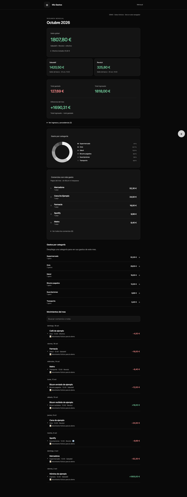

# Mis Gastos

**Aplicación de finanzas personales con sincronización bancaria y una interfaz pensada para móvil y escritorio.**

JavaScript · HTML/CSS · TypeScript · Deno · PostgreSQL · Supabase · Enable Banking · Netlify

Proyecto personal desarrollado de forma iterativa con asistencia de IA. Esta edición de portfolio incluye una demo independiente con datos ficticios, el frontend sin configuración de producción y el código del sincronizador bancario.

## Probar la demo

Abre [index.html](index.html) en el navegador o, con Node.js 24 o superior:

```sh
npm start
```

Visita `http://127.0.0.1:8781`. No requiere instalar paquetes, crear una cuenta ni configurar servicios. Puedes explorar los meses, el calendario, las categorías, los ingresos y los movimientos. Los cambios se guardan solo en la sesión de esa pestaña; en Ajustes puedes restablecer la demo.

**Todos los datos de la demo son ficticios. No conecta con bancos ni con el proyecto personal.**

## Vista de la demo



[Ver captura móvil](docs/mobile.png).

## Qué resuelve

- Unifica ingresos, gastos y efectivo en una vista mensual.
- Clasifica movimientos mediante reglas, conceptos y detección de Bizum.
- Permite editar movimientos y recuperar categorías o tarjetas eliminadas sin perder historial.
- Presenta saldos por cuenta, calendario de gastos, distribución por categorías, ranking de comercios y resumen anual.
- Distingue los traspasos internos para no inflar ingresos y gastos.

## Backend bancario

La aplicación privada utiliza Enable Banking para consultar cuentas autorizadas. El código de referencia incluido implementa:

- Importación de movimientos contabilizados en EUR a partir de una fecha de activación.
- Paginación y revisión de una ventana reciente para movimientos que llegan tarde.
- Deduplicación con SHA-256 de cuenta y referencia bancaria; borrar un movimiento no provoca su reimportación.
- Saldos bancarios obtenidos de snapshots independientes del historial editable.
- Procesamiento independiente de saldos y movimientos ante errores parciales.
- Bloqueo temporal de ejecución concurrente y programación en hora de Madrid.
- Credenciales del proveedor en Vault, autenticación del worker y aislamiento con permisos SQL y RLS.

La demo pública simula los resultados de este backend. No realiza llamadas bancarias.

## Decisiones técnicas

| Decisión | Motivo |
| --- | --- |
| Frontend autónomo sin framework ni compilación | Despliegue estático sencillo y pocas dependencias |
| Saldos bancarios separados de movimientos | Una edición en estadísticas no cambia lo comunicado por el banco |
| Referencias persistentes de importación | Evitar duplicados incluso después de borrar o editar |
| Efectivo manual | Mantener una fuente de verdad adecuada para cada medio de pago |
| Demo aislada del frontend conectado | Mostrar el proyecto sin requerir acceso a cuentas privadas |

El detalle de flujos, límites y permisos está en [Arquitectura](docs/ARCHITECTURE.md).

## Estructura

```text
index.html              Demo interactiva sin conexiones externas
index_netlify/          Frontend conectado con valores de configuración de ejemplo
banking/                Worker Deno, normalización y selección de saldos
banking/migrations/     Migración de referencia del sincronizador
banking/updates/        Evolución del backend, permisos y programación
tests/                  Pruebas offline y verificaciones SQL de referencia
scripts/                Servidor local, pruebas y comprobación de publicación
docs/                   Arquitectura, capturas y texto para CV
.github/workflows/      Verificaciones automáticas en GitHub Actions
```

## Verificación

Con Node.js 24 o superior:

```sh
npm test
npm run check:public
```

Las pruebas offline cubren reglas financieras, migración de ajustes, categorías, navegación, paginación, autenticación y fallos parciales con respuestas simuladas. No necesitan credenciales ni acceden a los bancos. GitHub Actions ejecuta estas mismas comprobaciones.

Los archivos `tests/*-database.sql` documentan pruebas de permisos e integridad sobre un entorno previamente preparado; no forman parte de `npm test`. **Este repositorio no es un instalador completo de Supabase.** Consulta [Configuración y alcance](docs/SETUP.md) antes de reutilizar el backend.

## Límites del proyecto

Los bancos pueden retrasar la contabilización y limitar consultas. Los consentimientos caducan y requieren renovación. La identificación se hace por cuenta, sin garantizar una tarjeta concreta. El sistema no promete reconciliar automáticamente registros manuales antiguos con movimientos bancarios.

La aplicación privada es de uso personal. Esta copia no incluye claves, sesiones, datos financieros del propietario, capturas de producción ni identificadores del despliegue real.

## Para el CV

Texto breve y descripción de competencias en [docs/CV.md](docs/CV.md).
