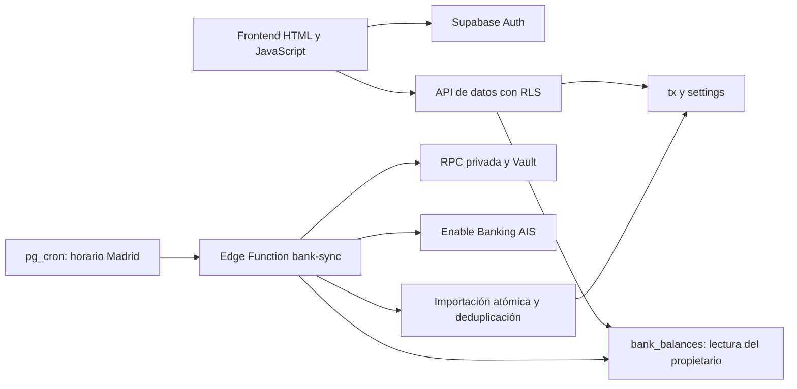

# Arquitectura

## Dos modos de uso

La demo de `index.html` reutiliza la interfaz de la aplicación con un conjunto generado de movimientos ficticios. Usa `sessionStorage` con nombres propios y una política CSP que prohíbe conexiones externas. El archivo `index_netlify/index.html` conserva el frontend conectado, con URL y clave pública sustituidas por ejemplos.

## Flujo de la aplicación privada

## Fuente de verdad

Los movimientos alimentan las estadísticas. Para bancos conectados, los saldos proceden de la API de saldos y no de sumar un saldo inicial al historial. El efectivo y las cuentas manuales se calculan a partir de su base e historial. Los importes se agregan en céntimos cuando corresponde para evitar desviaciones decimales.

## Sincronización e idempotencia

El worker obtiene configuración del servidor, valida un token, adquiere una lease e importa por lotes. Las referencias se generan mediante SHA-256 a partir de la identificación estable de la cuenta y la referencia del movimiento. `banking_private.seen` conserva esa identidad aunque el usuario borre el movimiento visible. Una ventana de revisión de siete días permite volver a consultar movimientos recientes; la fecha de activación limita la importación histórica.

Las consultas de transacciones y saldos se procesan por separado por banco. Un error no destruye el último saldo válido. Una ejecución parcial no avanza la última consulta global correcta, lo que permite revisar retrasos en la próxima ejecución.

## Permisos

- El navegador utiliza la sesión de Supabase Auth y permisos limitados por propietario.
- Las claves RSA, sesiones bancarias y token del worker no llegan al frontend.
- El esquema privado no tiene permisos para clientes. RLS actúa como defensa adicional.
- El worker utiliza una RPC autorizada al rol de servidor.
- `bank_balances` permite lectura al propietario; las escrituras se realizan en el servidor con una lease válida.
- Los códigos de error de sincronización evitan registrar conceptos, importes y secretos.

## Programación y límites

Un guard convierte el instante a `Europe/Madrid` y permite cuatro horarios locales. El trabajo cron se evalúa a la hora en punto, de modo que el cambio de horario estacional se resuelve con la zona horaria. Los límites efectivos dependen del banco y del proveedor. Las transacciones pendientes se excluyen hasta su contabilización.

## Compromisos

Un HTML autónomo simplifica el despliegue, pero concentra lógica y presentación. Un siguiente paso razonable sería separar módulos y añadir pruebas de navegador a CI. La edición pública conserva el diseño del proyecto original y no pretende ser una plataforma financiera multiusuario lista para producción.
